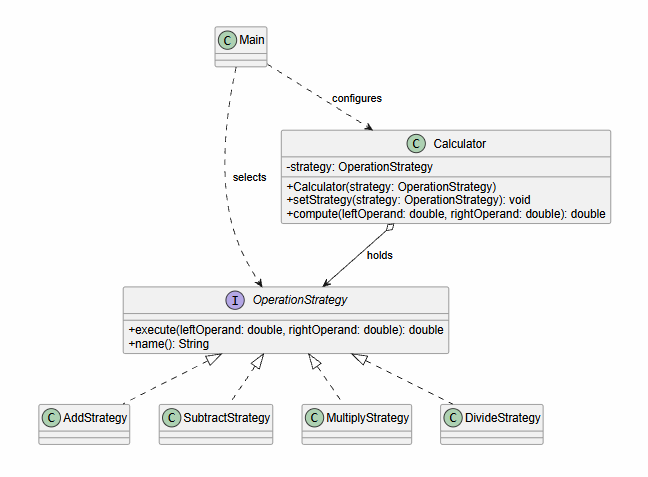

# Strategy Pattern - Calculator

**Name:** Assanbayev Yelaman  
**Group:** SE-2538  
**Topic:** B (Calculator)

## 1. Introduction

A two-operand calculator. The algorithm family is the four basic arithmetic operations: add, subtract, multiply, divide.
The user picks one at runtime. This fits Strategy because the operations are interchangeable and can grow.

## 2. UML Class Diagram

## 3. Clean Code Principles

**1. No conditionals - polymorphism instead.**  
Before:  
&emsp;if (op.equals("add))  
&emsp;&emsp;return a + b;  
&emsp;else if (op.equals("sub"))  
&emsp;&emsp;return a - b;  
&emsp;// ...  
After:  
&emsp;public double compute(double a, double b) {  
&emsp;&emsp;return strategy.execute(a, b); }  
The branching chain is gone. Calculator has no if/switch on strategy type.  

**2. Intention-revealing names.**  
Identifiers: `OperationStrategy`, `AddStrategy`, `execute`, `compute`, `setStrategy` - no op, a, x.  

**3. Single Responsibility.**  
Each strategy does one operation. `Calculator` only delegates. `Main` only handles input.

**4. Context is algorithm-agnostic.**  
`Calculator` imports only `OperationStrategy` - no type checks inside.  

**5. Easy to extend**  
New `ExampleStrategy` = one new class + one line in `Main`. Nothing else changes.  

## 4. Strategy vs. State  

**Strategy:** the client picks the algorithm, and strategies never trigger each other.  
**State:** the context changes its own state internally, and states move the context to sibling states.  
Our calculator has no lifecycle and no self-transitions, so Strategy is the correct choice.  

## 5. Conclusion  

**Gained:** algorithms can be swapped at runtime, tested alone, and added without touching existing code.  
**Cost:** one interface + one small class per operation - more files than a switch, but each is trivial. Worth it when operations grow.  

## GitHub Repository

https://github.com/assanbayevelaman-cmyk/SDP_Assignment5
